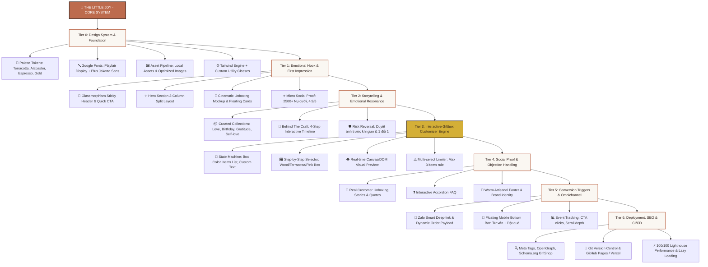

# 🌳 TECH TREE: THE LITTLE JOY LANDING PAGE
> **Dự án:** Landing Page "Giftbox Cá Nhân Hóa"  
> **Slogan:** *"Made from little moments, made for someone special"*  
> **Kiến trúc:** High-Converting Single Page Application (Lightweight, Mobile-First, Vanilla JS + Tailwind CSS)

---

## 1. Sơ Đồ Cây Công Nghệ (Mermaid Tech Tree Diagram)

---

## 2. Chi Tiết Các Tầng Công Nghệ (Tech Tree Breakdown)

### 🌿 TIER 0: NỀN TẢNG THIẾT KẾ & HỆ THỐNG TOKENS (FOUNDATION)
* **Design Tokens (CSS Variables & Tailwind Config):**
  * `Primary`: `#BD6B4D` (Terracotta mộc ấm) | `Primary Hover`: `#A45538`
  * `Secondary`: `#F4DCD1` (Blush pastel)
  * `Surface`: `#FAF7F2` (Alabaster nền kem ấm)
  * `Card`: `#FFFFFF`
  * `Text Main`: `#2C1E1A` (Espresso) | `Text Muted`: `#7A6B65`
  * `Accent`: `#D4AF37` (Champagne Gold)
* **Typography Stack:**
  * Headings / Serif: `'Playfair Display', serif`
  * Body / Sans: `'Plus Jakarta Sans', sans-serif`
* **Local Asset Pipeline:** Quản lý kho ảnh thực tế trong `./Images/` (Logo, hình sản phẩm, sáp niêm phong).

---

### 🌸 TIER 1: BRAND IDENTITY & GÂY ẤN TƯỢNG ĐẦU TIÊN (HOOK LAYER)
* **Glassmorphic Sticky Nav:**
  * Backdrop-blur header với độ trong suốt tinh tế.
  * Logo thương hiệu + navigation liên kết mượt (Smooth Scrolling) + Mini-CTA "Đặt làm ngay".
* **Hero Section (High-CRO Split):**
  * Typography nổi bật với badge cảm xúc *"✨ Hộp quà cá nhân hóa theo từng câu chuyện"*.
  * H1 Headline định vị: *"Gói ghém yêu thương từ những khoảnh khắc nhỏ nhất"*.
  * Bộ đôi CTA: Button chính (Primary Glow) + Button phụ ("Xem video unboxing").
  * Visual Hero: Mockup hộp quà mở nắp nghệ thuật kết hợp floating badge *"Thiệp viết tay riêng cho..."*.

---

### 🌿 TIER 2: NGHỆ THUẬT KỂ CHUYỆN & GIẢI TOẢ TÂM LÝ (STORYTELLING)
* **Curated Collections Grid:**
  * Phân nhóm theo nhu cầu: *Anniversary / Birthday Joy / Gratitude / Self-love*.
  * Micro-hover effect (zoom nhẹ, viền bóng mượt, hiển thị chi tiết tặng phẩm).
* **"Behind The Craft" - Hành Trình 4 Bước:**
  * Step 1: Lắng nghe & Khởi tạo ý niệm.
  * Step 2: Tuyển chọn tặng phẩm thủ công.
  * Step 3: Cá nhân hóa (In ảnh mini, khắc tên laser, viết thiệp sáp).
  * Step 4: Đóng gói 3 lớp chống sốc & niêm phong con dấu sáp.
* **Risk Reversal Badges:**
  * Cam kết gửi ảnh duyệt trước khi ship.
  * 1 đổi 1 lập tức nếu cấn móp trong quá trình vận chuyển.

---

### ⚡ TIER 3: TRÁI TIM TƯƠNG TÁC (CORE INTERACTIVE ENGINE)
* **Giftbox Customizer Widget (Vanilla JS Engine):**
  * **State Management:** Quản lý trạng thái hộp quà (Box color, selected gifts, recipient name, custom message).
  * **Interactive Selectors:**
    * Lựa chọn chất liệu/màu hộp (Gỗ mộc, Terracotta, Pastel Blush).
    * Giới hạn thông minh: Chọn tối đa 3 món quà (nến thơm, lọ trà hoa, sổ tay, khăn lụa, khung ảnh polaroid).
    * Ô nhập liệu trực tiếp tên người nhận và thông điệp.
  * **Live DOM Visualizer:** Tên người nhận và các món quà được hiển thị trực quan lên hộp quà mô phỏng theo thời gian thực (Real-time Preview).

---

### 💌 TIER 4: BẰNG CHỨNG XÃ HỘI & GIẢI TỎA LO ÂU (TRUST & PROOF)
* **Customer Joy Stories:**
  * Masonry / Grid hiển thị khoảnh khắc mở hộp thực tế từ khách hàng.
  * Quote trích dẫn cảm xúc ấm áp và đánh giá 5 sao.
* **Interactive Accordion FAQ:**
  * Trả lời 4 khúc mắc phổ biến: Thời gian giao hàng hỏa tốc, gửi ảnh cá nhân/mã Spotify, chính sách bảo hành khi vận chuyển, dịch vụ gửi tặng bí mật.

---

### 🚀 TIER 5: BỘ CHUYỂN ĐỔI & TỐI ƯU MOBILE (CONVERSION LAYER)
* **Smart Zalo Deeplink:**
  * Tự động tổng hợp cấu hình hộp quà mà khách vừa tạo (Màu hộp + Món đã chọn + Tên người nhận) thành nội dung tin nhắn gửi thẳng tới Zalo OA/Số hotline:
    `https://zalo.me/[SDT]?text=Chào%20The%20Little%20Joy,%20mình%20muốn%20đặt%20hộp%20quà...`
* **Mobile Sticky Bottom Bar:**
  * Thanh ghim đáy màn hình thông minh (chỉ hiện khi cuộn qua Hero Section).
  * 2 Action: Nút nhắn tin tư vấn nhanh + Nút Primary cuộn mượt đến bộ phối quà.
* **CRO Event Tracking:**
  * Gắn định danh cho các nút hành động (Hero CTA, Customizer Submit, Sticky Mobile).

---

### 🌐 TIER 6: SEO, DEPLOYMENT & QUẢN LÝ PHIÊN BẢN (DISTRIBUTION)
* **Git Version Control:** Khởi tạo repository Git, cấu hình `.gitignore` chuẩn.
* **SEO Metadata:** Meta tags chuẩn OpenGraph (OG Title, OG Image, OG Description) cho hiển thị đẹp khi chia sẻ link qua Zalo/Facebook.
* **Ready for Deployment:** Tương thích 100% với GitHub Pages, Vercel, Netlify (Zero-configuration static build).
